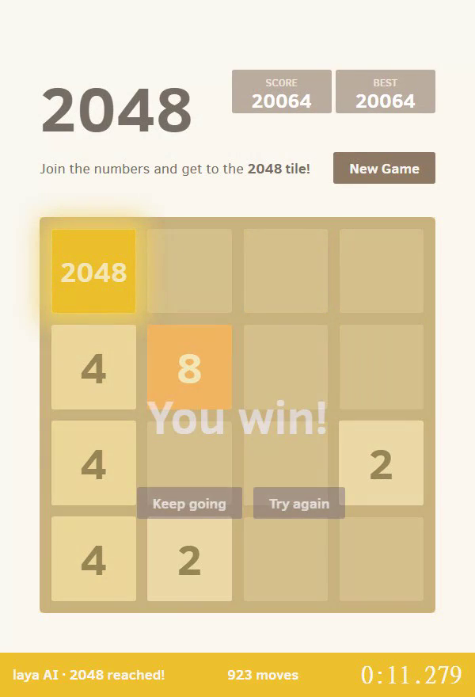

# laya plays 2048

**English** | [中文](README.zh-TW.md)

Teaching the text-decision model [convaiinnovations/laya](https://huggingface.co/convaiinnovations/laya)
to play the web version of 2048: imitation learning from an expectimax search, then DAgger to make it
stronger, and finally CUDA graphs for speed. It **reaches the 2048 tile in about 11 seconds**.

**Trained model:** [linpanda/laya-2048](https://huggingface.co/linpanda/laya-2048) on Hugging Face



Demo video: [docs/demo.mp4](docs/demo.mp4) (11.279 s, 923 moves)

## Results

64 games played by the model itself in a simulator (same random seeds for every row):

| Stage | Avg. score | Reached 2048 | Reached 4096 |
|---|---|---|---|
| Original laya (untrained) | ~1,000 | 0 | 0 |
| After imitating expectimax | 15,000 | 17/64 | 1/64 |
| After 3 DAgger rounds | 42,720 | 48/64 | 27/64 |
| After 5 DAgger rounds | 45,379 | 51/64 | 33/64 |

Speedrun ([speedrun.py](speedrun.py)): about 12 ms per move, about 950 moves to reach 2048, **about 11 seconds**.

## How it works

1. **Turn 2048 into a four-way choice.** The board is written as text and laya is asked which of
   up / down / left / right is best. laya is a classifier that scores every option in one forward pass
   (ModernBERT-large, 421M parameters). Out of the box it plays no better than random key presses.
2. **Imitation learning** ([teach_laya.py](teach_laya.py) `gen` / `train`). An expectimax search plays by
   itself, every board and the move it chose are recorded, and laya is fine-tuned to pick the same move.
3. **DAgger** (`teach_laya.py dagger`). laya plays by itself, a stronger teacher ([teacher.py](teacher.py),
   about 108,000 points on average) labels every board laya visited, and laya is trained again on all the
   data so far. This teaches it how to recover from its own mistakes, which works much better than
   imitation alone.
4. **Speedrun acceleration** ([speedrun.py](speedrun.py)). The model is called directly, bypassing the laya
   package wrapper, and the whole forward pass is captured once as a CUDA graph and replayed every move.
   Inference drops from about 50 ms to about 7 ms per move. The script also skips moves that would not
   change the board and makes a single round trip to the browser per move.

The game is the original open-source 2048 by Gabriele Cirulli ([game2048/](game2048/), MIT license),
served locally and controlled with Playwright.

## Usage

Requires Python 3.10+ and an NVIDIA GPU (for training and the speedrun).

```bash
pip install -r requirements.txt
python -m playwright install chromium
```

### 1. Get the model

The weights (421M parameters, about 840 MB in float16) are too large for GitHub.

**Option A: download the trained model** from Hugging Face into the folder the scripts expect:

```bash
hf download linpanda/laya-2048 --local-dir laya_2048_dagger
```

**Option B: train it yourself** (about 7–8 hours in total on an RTX 4090):

```bash
python teach_laya.py gen --games 200     # teacher demonstrations -> data_2048.jsonl
python teach_laya.py train --epochs 2    # imitation learning -> laya_2048_model/
python teach_laya.py dagger --iters 5    # DAgger -> laya_2048_dagger/
python teach_laya.py eval --games 64 --model-dir laya_2048_dagger
```

The first run downloads the original laya from Hugging Face into `laya_model/`.

### 2. Watch it play

```bash
python play_2048.py --mode laya --model-dir laya_2048_dagger   # trained laya
python play_2048.py --mode laya                                # original laya, for comparison
python play_2048.py --mode expectimax                          # the teacher, no model needed
```

### 3. Speedrun with recording

```bash
python speedrun.py              # stops once 2048 is reached (up to 10 tries); records the successful run to videos/
python speedrun.py --no-record  # no recording
```

The timer starts at the first key press and stops when the 2048 tile appears. A timer and move counter
are shown at the bottom of the page.

## About speedrun.com

This is a program playing, so it does **not** meet the rules of
[speedrun.com/2048](https://www.speedrun.com/2048) (macros are banned, only human input is accepted, and
runs must be on a verified version of the game). Please do not submit these times to the human leaderboards.

## Files

| File | Purpose |
|---|---|
| [play_2048.py](play_2048.py) | Play 2048 in a browser; `--mode laya / lookahead / expectimax` |
| [teach_laya.py](teach_laya.py) | Data generation, fine-tuning, DAgger, evaluation |
| [teacher.py](teacher.py) | Stronger expectimax teacher (labels for DAgger) |
| [speedrun.py](speedrun.py) | Speedrun: CUDA graph acceleration and recording |
| [bench_teacher.py](bench_teacher.py) | Compares the strength and speed of the old and new teachers |
| [game2048/](game2048/) | Original 2048 web game (MIT, © Gabriele Cirulli) |

## Credits and license

The code in this project is released under the [MIT](LICENSE) license.

- Base model: [convaiinnovations/laya](https://huggingface.co/convaiinnovations/laya) (Apache-2.0)
- Trained model: [linpanda/laya-2048](https://huggingface.co/linpanda/laya-2048) (Apache-2.0, same as the base model)
- Game: [gabrielecirulli/2048](https://github.com/gabrielecirulli/2048) (MIT), see [game2048/LICENSE.txt](game2048/LICENSE.txt)
